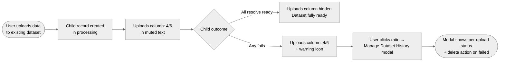

# PRD: Dataset Status Contract

**Area:** Platform  
**Author:** Chess | **Date:** 2026-06-19 | **Version:** v5  
**Status:** Draft  
**Pipeline stage:** Solution Shaping  
**Product brief:** [brief-dataset-status-contract-2026-05-21.md](../../../product-brief-writer/output/platform/brief-dataset-status-contract-2026-05-21.md)  
**Companion fix (Sprint 7):** [brief-dataset-status-sync-2026-05-18.md](../../../product-brief-writer/output/platform/brief-dataset-status-sync-2026-05-18.md)

---

## Context

-**Strategic fit:**

Users look at a dataset's "status" (like "ready") to know if it's safe to use. Right now, nobody has clearly defined what "ready" actually means, and different parts of the system check for "ready" in different, inconsistent ways. This PRD is about fixing that ambiguity.

- **Related products:**

This touches four things: the Datasets module (what users see), the Web App (UI), the upload pipeline (how data gets in), and the hydration service — which is the backend process that populates two specific database tables (DataCollections and DataCollectionDetails) with the actual data.

- **Scope relationship:** The Sprint 7 rehydration fix was supposed to address the write-path bug for cust_id / dedupe changes (not completed in Sprint 6 — slipped). This PRD addresses the upload aggregation gap and establishes the status contract that governs both fixes and prevents recurrence.

---

## Problem

The dataset `ready` status does not truthfully represent a dataset's readiness for consumption. Two lifecycle triggers have been confirmed where the UI shows `ready` when the dataset is not:

**Trigger 1 — Upload to existing dataset:** When a user uploads new data, child sub-dataset records go through their own `processing` → `ready` / `failed` lifecycle. The parent dataset status is never updated to reflect this — it stays `ready` regardless of what its children are doing.

**Trigger 2 — Customer identifier or dedupe field change:** This triggers a full dataset rehydration. The hydration service writes status to `[dat].[DataCollections]`, but the UI reads from `[dat].[DataCollectionDetails]` — which rehydration does not write to. The dataset shows `ready` while actively rebuilding.

**Trigger 3 — Review action on failed upload:** When a user reviews a dataset upload marked with errors, the review action writes back to the parent dataset status, moving it from `ready` to `unregistered`. This affects all upload reviews. Unlike Triggers 1 and 2 (which silently show the wrong state), this is an active regression — a user who reviews a failed upload loses access to a dataset that was previously usable.

All three failures share the same root: there is no enforced rule for what `ready` means across dataset lifecycle flows. Each flow writes status differently, with no single source of truth.

### Evidence

| Source | Signal | Confidence |
|--------|--------|:----------:|
| PM observation | Parent stays `ready` while child uploads are `processing` or `failed` — reproduced in live product | confirmed |
| Rudy / MAF UAE ([869bbv7dj](https://app.clickup.com/t/869bbv7dj)) | cust_id change → rehydration → UI showed `ready` throughout rebuild | confirmed |
| Code review (Rudy) | Root cause: UI reads `DataCollectionDetails`; rehydration writes `DataCollections` only | confirmed |
| JTBD analysis (2026-05-21) | Root job opportunity score: 19/20 — "when I change my dataset, I want the status to reflect what's happening" | indicated |

| Prepared Datasets flow | Status write source unknown — may be a fourth affected flow | assumed |

### Context
- **Dynamic:** Internal platform initiative — triggered by confirmed client impact (MAF) and PM-identified structural risk
- **Impact of inaction:** Users consume, share, or build on datasets they believe are complete. The system does not error — it silently serves wrong or incomplete results. Silent data integrity failures in client environments (audience targeting, campaign matching) with no visible warning

---

## Target Segment

- **Internal team:** Platform engineering — owns the status write path and aggregation logic
- **Platform users:** Any client who uploads to an existing dataset or changes a customer identifier — which covers the standard ongoing dataset management workflow
- **Downstream consumers:** Analytics, cleanroom, marketplace — anything that reads dataset status to decide whether to run
- **Primary persona:** The data manager / analyst who owns a dataset, makes changes to it over time, and trusts the status signal to know when it's safe to use

---

## Technical Architecture

**System components involved:**
- `[dat].[DataCollections]` — dataset-level status record (written by rehydration, new upload)
- `[dat].[DataCollectionDetails]` — detail-level status record (read by UI; written by upload, PII leak, not rehydration)
- Upload pipeline — creates child sub-dataset records on upload to existing dataset
- Hydration service (Werner) — triggers status writes on cust_id / dedupe field change
- Web App (Datasets module) — reads `DataCollectionDetails` to display status; needs to render new composite states

**Current status write matrix (pre-fix):**

| Flow | Writes DataCollections | Writes DataCollectionDetails |
|---|:---:|:---:|
| New upload | ✓ | ✓ |
| Existing upload | — | ✓ |
| PII leak detection | — | ✓ |
| Rehydration (cust_id / dedupe change) | ✓ | — |
| Review failed upload | ✓ (incorrectly writes `unregistered` to parent) | ❓ |
| Prepared Datasets | ❓ | ❓ |

**Integration points:**
- Upload service → upload count / status query for the Uploads column (read-only, no new writes)
- Hydration service → `DataCollectionDetails` write path (Sprint 6 fix, prerequisite)
- Web App datasets table → new Uploads column, tooltip components, visual state logic
- Manage Dataset History modal → must surface per-upload status (processing / failed) and retry action

**Tenant model:** Multi-tenant — all clients are affected equally. Column is dataset-scoped, not tenant-scoped.

**API surface:** One new read endpoint or query extension anticipated — return upload count and status breakdown (total, ready, processing, failed) per dataset for the table column. No writes.

**Service dependencies:**
- Sprint 7 rehydration fix must be deployed before or alongside this work — it establishes the `DataCollectionDetails` write pattern that this PRD builds on
- Werner sign-off on rehydration write path (whether `DataCollectionDetails` bypass was intentional) is a prerequisite for both fixes

**Service level objectives:**

| Metric | Target | Measurement |
|---|---|---|
| Uploads column accuracy | Ratio reflects actual child states within 30s of state change | Automated test on upload trigger |
| UI error rate on column render | <0.1% | App error logging on datasets table |
| Modal status accuracy | Processing / failed distinction correct for all child records | QA test suite |

---

## Scope

### Appetite
Small–Medium. Discovery spike (1–2 days) to confirm data model, then targeted fix. If Sprint 7 creates a reusable propagation pattern, this may fold into Sprint 7 scope alongside the rehydration fix.

### In Scope
- New **Uploads column** on the datasets table showing digested/total ratio (e.g. `4/6`)
- Column is **empty** when a dataset has no uploads — only renders when some uploads are still ingesting
- **Visual treatment:** ratio shown in text — no failed state treatment on the column; the column is a progress indicator only (digested/total)
- **Tooltip on Uploads column:** contextual copy explaining what the ratio means (see Solution Direction)
- **Tooltip on Status column:** "Reflects the readiness of your base dataset, not including uploads." — resolves the apparent contradiction between `ready` and an incomplete ratio
- **Click-through:** ratio is clickable → opens existing Manage Dataset History modal (no changes to modal required)
- Status contract documentation: authoritative status write rule per flow — required as AC for Done
- Investigation of Prepared Datasets status source (must be resolved before this fix closes)

### No-Gos
- The **Status column value does not change** — `ready` continues to reflect the base dataset only
- No composite status logic that changes the parent dataset state
- No redesign of the upload flow or dataset creation experience
- No new notification or alerting system (email, push, in-app toasts)
- No changes to how sub-dataset records are created or stored
- No changes to upload, PII leak, or any flow not explicitly in scope
- No failed state treatment on the Uploads column — the column shows digested/total progress only

### Rabbit Holes

| Rabbit Hole | Why It Could Expand | Mitigation |
|---|---|---|
| Expanding the Manage Dataset History modal | Once we're in the modal, it's tempting to redesign it | No modal changes in scope — click-through uses it as-is |
| Retry management flow | "While we're here, let's build a full retry queue" | Out of scope — no retry UI in this feature |
| Notification system | Surfacing failure could prompt "while we're here, add email alerts" | Out of scope for this PRD; capture as a follow-on idea |
| Showing the column for all-ready datasets | "Should we show 6/6 as a permanent column?" | Column is empty / hidden when all uploads are ready — absence is the positive signal |
| Historical status audit trail | "Can we show when each upload completed?" | Defer to future consideration |

### Future Considerations
- In-app or email notifications on upload failure
- Status history / audit trail (what triggered the last state change, when)
- Progress indicator during rehydration ("~12 min remaining")
- Unified status model review if Prepared Datasets reveals a third broken flow

---

## Solution Direction

Add an **Uploads column** to the datasets table that surfaces upload readiness as a ratio (e.g. `4/6`). The **Status column is unchanged** — it continues to reflect the base dataset only. The two columns answer different questions: Status tells the user whether their dataset is usable; Uploads tells them whether all their data is in. Tooltips on both columns make this distinction explicit. The ratio is clickable, opening the existing Manage Dataset History modal — which already shows per-upload status and a delete action. No modal changes required; the click-through surfaces failure context and allows deletion of failed uploads.

### Column Behaviour

| State | Uploads column display | Tooltip |
|---|---|---|
| No uploads on dataset |  empty | — |
| All uploads ready | Show count of all uploaded datasets | — |
| Uploads in progress | `4/6` in text | "4 of 6 uploaded files are ready. Your dataset is available to use — remaining uploads are still processing." |
| One or more failed | `4/6` + existing warning symbol | "4 of 6 uploaded files are ready. 1 failed — click to review." |

**Visual consistency note:** The warning symbol already exists in the datasets table for the "review required" state on newly uploaded datasets. Reusing it here means users immediately understand the failed upload state requires action — no new icon or pattern to learn.

**Status column tooltip (all states):**
> "Reflects the readiness of your base dataset, not including uploads."

### Key User Flow

1. User uploads new data to an existing dataset
2. Child upload records enter `processing` — the Uploads column appears showing the ratio in text (e.g. `4/6`)
3. The Status column remains `ready` — the base dataset is still usable
4. User can continue working with the dataset while uploads are in flight
5. If all uploads resolve to `ready` → the Uploads column shows all uploaded datasets e.g. `6/6`)
6. If any upload fails → the ratio gains a warning icon; tooltip explains a failure needs attention
7. User clicks the ratio → Manage Dataset History modal opens
8. Modal shows each upload with its status clearly labelled (`processing` / `failed`); user can delete a failed upload if needed and re-upload manually

---

## Dependencies

| Type | Dependency | Why Needed | Status / Timeline |
|---|---|---|---|
| Feature | Sprint 7 rehydration fix (Werner) | Ensures cust_id / dedupe change also surfaces correctly in the uploads context | Not shipped in Sprint 6 — targeting Sprint 7, pending Werner sign-off |
| Team | Werner (hydration service owner) | Must confirm rehydration write-path intent | Pending — blocker for Sprint 7 |
| Investigation | Prepared Datasets status source | Must be resolved before this PRD closes — could reveal a third affected flow | Not started |
| Design | Tooltip and column visual spec | Warning icon, muted text treatment, tooltip copy need design sign-off before build | Not started |
| ~~Investigation~~ | ~~Current Manage Dataset History modal~~ | ~~Must confirm modal currently distinguishes processing vs failed per upload, and has a retry action — or scope expands~~ | **Resolved** — modal shows status + delete; no modal changes required |

**Critical path:** Confirming what the Manage Dataset History modal currently shows. If it only lists uploads without per-record status or retry, the modal needs changes — which adds scope to this PRD before dev can start.

---

## Success Metrics

### Lagging Indicators

| Metric | Baseline | Target | Timeframe |
|---|---|---|---|
| Client-reported incidents of acting on a dataset with unresolved uploads | [PLACEHOLDER — need actual baseline from support] | 0 per quarter | 1 quarter post-release |
| Upload failures discovered late (after downstream use) | [PLACEHOLDER] | 0 per quarter | 1 quarter post-release |
| Prepared Datasets status accuracy | Unknown | Defined + correct | Before PRD closes |

### Leading Indicators

| Signal | Current | Target | Predicts |
|---|---|---|---|
| Uploads column accuracy (ratio matches actual child states) | Not measured | 100% within 30s | Column is a trustworthy signal |
| Flows with documented status contract | 0 / 5 | 5 / 5 | No new flows silently break status |
| Modal click-through rate on warning state | Not measured | [PLACEHOLDER — establish post-launch] | Users are seeing and acting on failure signals |

---

## Risks

### V/U/F/V/O Assessment

| Type | Risk | Impact | Mitigation |
|---|---|:---:|---|
| **Value** | Problem is real and confirmed — low risk here | L | — |
| **Usability** | Two columns answering different questions could still confuse users without clear labels and tooltips | M | Tooltip copy and column header must be finalised before build; "Uploads" is the proposed header — validate with a user if time allows. Warning symbol reuse aligns with existing table pattern, reducing learning curve. |
| **Feasibility** | ~~Modal may not currently distinguish processing vs failed per upload — if not, modal changes add scope~~ | ~~M~~ | **Resolved** — modal shows processing / failed / ready per upload. No scope impact. |
| **Viability** | No commercial model risk | L | — |
| **Operational** | Read query for upload ratio adds load to datasets table — at scale with many datasets, this could affect page performance | M | Confirm query performance with engineering before build; consider caching the ratio |

### Operational Risk (Expanded)

- **Blast radius:** Low — this is a read-only UI addition. No changes to status writes, no changes to parent dataset state. A bug renders a wrong ratio or missing column; it does not affect data or downstream flows.
- **Backward compatibility:** Additive change to the datasets table — no existing columns or behaviours change.
- **Migration safety:** No migration required. The column reads existing child record data.
- **Multi-tenancy:** All tenants see the column when applicable. No tenant-specific logic.
- **On-call burden:** Minimal. The column is a synchronous read; no new async jobs, polling, or webhooks.

---

## Open Questions

| Question | Who Can Answer | Needed By | Validation Approach |
|---|---|---|---|
| ~~What does the Manage Dataset History modal currently show per upload — does it distinguish processing vs failed, and is there a retry action?~~ | — | **Resolved** | Modal shows per-upload status + delete action. No retry. No modal changes required. |
| Is `DataCollectionDetails` deliberately bypassed during rehydration? | Werner | Before Sprint 7 dev starts | Direct conversation — blocker for Sprint 7 |
| How are upload sub-records linked to the parent in the status tables — what query gives us the ratio? | Data architect / Engineering | Sprint 7 planning | 1-day discovery spike against the schema |
| Does the ratio query perform acceptably at scale (many datasets, many uploads)? | Engineering | Before build | Load test the query in staging |
| What is the Prepared Datasets status source — and is it affected? | Engineering | Before this PRD closes | Code investigation; add to Sprint 7 spike scope |

---

## Sign-off

| Role | Name | Status |
|---|---|---|
| Product owner | Chess | Draft |
| Engineering lead | — | Pending |
| Platform architect / Werner | — | Pending — blocker |
| Security | — | Not required (no new data surface) |

---

## Version History

| Version | Date | Author | Changes |
|---|---|---|---|
| v1 | 2026-05-21 | Chess | Initial draft — composite status logic approach (parent derives worst-child state) |
| v2 | 2026-05-22 | Chess | Solution direction changed — Uploads ratio column on datasets table. Status column unchanged. Click-through to Manage Dataset History modal. Visual treatment: muted for processing, warning icon for failed. Tooltips on both columns to resolve apparent contradiction. |
| v3 | 2026-06-17 | Chess | Rehydration fix slipped Sprint 6 — all Sprint 6 references updated to Sprint 7. Dependency status updated to reflect slip. |
| v4 | 2026-06-18 | Chess | Trigger 3 added: review action on failed upload moves parent dataset to `unregistered` — reproduced across all upload reviews, Werner-owned. Added to Problem, Evidence, write matrix, Scope, Solution Direction, and Open Questions. Write matrix now shows 4 confirmed broken flows + Prepared Datasets unknown. |
| v5 | 2026-06-19 | Chess | Modal question resolved: shows per-upload status + delete action, no retry. Solution direction, column tooltip, key user flow, mermaid diagram, open questions, and dependencies updated to reflect delete-only. No modal changes in scope. |
