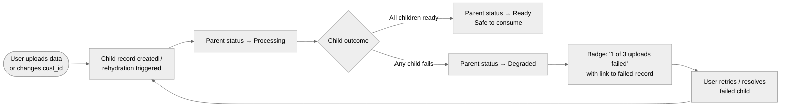
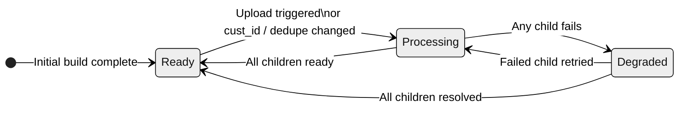

# PRD: Dataset Status Contract

**Area:** Platform  
**Author:** Chess | **Date:** 2026-05-21 | **Version:** v1 (archived)  
**Status:** Superseded by v2  
**Pipeline stage:** Solution Shaping  
**Product brief:** [brief-dataset-status-contract-2026-05-21.md](../../../product-brief-writer/output/platform/brief-dataset-status-contract-2026-05-21.md)  
**Companion fix (Sprint 6):** [brief-dataset-status-sync-2026-05-18.md](../../../product-brief-writer/output/platform/brief-dataset-status-sync-2026-05-18.md)

> **Note:** This version proposed composite status logic — the parent dataset status derives from the worst-child state. This approach was superseded in v2 by an Uploads ratio column on the datasets table, which keeps the Status column unchanged and separates the two signals. See [prd-dataset-status-contract-2026-05-21.md](prd-dataset-status-contract-2026-05-21.md) for the current version.

---

## Context

- **Strategic fit:** Platform reliability — dataset status is the primary signal users rely on to decide when data is safe to consume. The contract for what `ready` means is currently undefined and inconsistently applied across lifecycle flows
- **Related products:** Datasets module, Web App, upload pipeline, hydration service (`[dat].[DataCollections]` / `[dat].[DataCollectionDetails]`)
- **Scope relationship:** The Sprint 6 rehydration fix addresses the write-path bug for cust_id / dedupe changes. This PRD addresses the upload aggregation gap and establishes the status contract that governs both fixes and prevents recurrence

---

## Problem

The dataset `ready` status does not truthfully represent a dataset's readiness for consumption. Two lifecycle triggers have been confirmed where the UI shows `ready` when the dataset is not:

**Trigger 1 — Upload to existing dataset:** When a user uploads new data, child sub-dataset records go through their own `processing` → `ready` / `failed` lifecycle. The parent dataset status is never updated to reflect this — it stays `ready` regardless of what its children are doing.

**Trigger 2 — Customer identifier or dedupe field change:** This triggers a full dataset rehydration. The hydration service writes status to `[dat].[DataCollections]`, but the UI reads from `[dat].[DataCollectionDetails]` — which rehydration does not write to. The dataset shows `ready` while actively rebuilding. *(Root cause confirmed; fix scoped in Sprint 6 pending Werner sign-off.)*

Both failures share the same root: there is no enforced rule for what `ready` means across dataset lifecycle flows. Each flow writes status differently, with no single source of truth.

### Evidence

| Source | Signal | Confidence |
|--------|--------|:----------:|
| PM observation | Parent stays `ready` while child uploads are `processing` or `failed` — reproduced in live product | confirmed |
| Rudy / MAF UAE ([869bbv7dj](https://app.clickup.com/t/869bbv7dj)) | cust_id change → rehydration → UI showed `ready` throughout rebuild | confirmed |
| Code review (Rudy) | Root cause: UI reads `DataCollectionDetails`; rehydration writes `DataCollections` only | confirmed |
| JTBD analysis (2026-05-21) | Root job opportunity score: 19/20 — "when I change my dataset, I want the status to reflect what's happening" | indicated |
| Prepared Datasets flow | Status write source unknown — may be a third affected flow | assumed |

### Context
- **Dynamic:** Internal platform initiative — triggered by confirmed client impact (MAF) and PM-identified structural risk
- **Impact of inaction:** Users consume, share, or build on datasets they believe are complete. The system does not error — it silently serves wrong or incomplete results. Silent data integrity failures in client environments (audience targeting, campaign matching) with no visible warning

---

## Target Segment

- **Internal team:** Platform engineering — owns the status write path and aggregation logic
- **Platform users:** Any client who uploads to an existing dataset or changes a customer identifier — which covers the standard ongoing dataset management workflow
- **Downstream consumers:** Analytics, cleanroom, marketplace — anything that reads dataset status to decide whether to run
- **Primary persona:** The data manager / analyst who owns a dataset, makes changes to it over time, and trusts the status signal to know when it's safe to use

---

## Technical Architecture

**System components involved:**
- `[dat].[DataCollections]` — dataset-level status record (written by rehydration, new upload)
- `[dat].[DataCollectionDetails]` — detail-level status record (read by UI; written by upload, PII leak, not rehydration)
- Upload pipeline — creates child sub-dataset records on upload to existing dataset
- Hydration service (Werner) — triggers status writes on cust_id / dedupe field change
- Web App (Datasets module) — reads `DataCollectionDetails` to display status; needs to render new composite states

**Current status write matrix (pre-fix):**

| Flow | Writes DataCollections | Writes DataCollectionDetails |
|---|:---:|:---:|
| New upload | ✓ | ✓ |
| Existing upload | — | ✓ |
| PII leak detection | — | ✓ |
| Rehydration (cust_id / dedupe change) | ✓ | — ← Sprint 6 bug |
| Prepared Datasets | ❓ | ❓ |

**Integration points:**
- Upload service → parent status aggregation logic (new dependency)
- Hydration service → `DataCollectionDetails` write path (Sprint 6 fix, prerequisite)
- Web App dataset card / header → new composite state rendering

**Tenant model:** Multi-tenant — all clients are affected equally. Status logic is dataset-scoped, not tenant-scoped.

**API surface:** No new public endpoints anticipated. Status aggregation is internal read/write logic. UI changes are additive (badge/count on existing dataset surface).

**Service dependencies:**
- Sprint 6 rehydration fix must be deployed before or alongside this work — it establishes the `DataCollectionDetails` write pattern that this PRD builds on
- Werner sign-off on rehydration write path (whether `DataCollectionDetails` bypass was intentional) is a prerequisite for both fixes

**Service level objectives:**

| Metric | Target | Measurement |
|---|---|---|
| Status propagation latency | Parent reflects child state within 30s of child state change | Automated test on upload / rehydration trigger |
| Status accuracy | 100% — no `ready` shown when any child is non-ready | QA test suite covering all 5 flows |
| UI error rate on new states | <0.1% | App error logging on dataset card render |

---

## Scope

### Appetite
Small–Medium. Discovery spike (1–2 days) to confirm data model, then targeted fix. If Sprint 6 creates a reusable propagation pattern, this may fold into or immediately follow Sprint 6 scope.

### In Scope
- Composite status logic: parent dataset status derived from worst-child state across all upload sub-records
- `ready` at parent level means all children are `ready` — no exceptions
- `processing` at parent level when any child is `processing`
- Degraded / action-required state at parent level when any child has `failed`
- UI: badge or inline count on parent dataset ("3 of 4 uploads ready · 1 failed")
- UI: direct path from parent to failed child record with retry or resolution action
- Status contract documentation: authoritative status write rule per flow — required as AC for Done on both this fix and Sprint 6
- Investigation of Prepared Datasets status source (must be resolved before this fix closes)

### No-Gos
- No redesign of the upload flow or dataset creation experience
- No new notification or alerting system (email, push, in-app toasts) — surface-level badge only
- No changes to how sub-dataset records are created or stored
- No changes to upload, PII leak, or any flow not explicitly in scope
- No new public API endpoints

### Rabbit Holes

| Rabbit Hole | Why It Could Expand | Mitigation |
|---|---|---|
| Redefining the status model globally | There's a temptation to redesign all dataset states while we're in this code | Scope to composite logic only — no new top-level status types unless a `partial` state is approved as a product decision |
| Retry / resolution UX | "Link to failed record" could become a full retry management flow | Surface the link and existing retry mechanism only — no new retry UI |
| Notification system | Surfacing failure could prompt "while we're here, add email alerts" | Out of scope for this PRD; capture as a follow-on idea |
| Historical status audit trail | "Can we show why the status changed?" is adjacent but separate | Defer to future consideration |

### Future Considerations
- In-app or email notifications on upload failure
- Status history / audit trail (what triggered the last state change, when)
- Progress indicator during rehydration ("~12 min remaining")
- Unified status model review if Prepared Datasets reveals a third broken flow

---

## Solution Direction

Introduce composite status logic for parent datasets: the parent derives its status from the worst-child state across all associated upload records. `ready` is only displayed when all children are `ready`. Failure is surfaced at the parent level with enough inline detail for the user to act without drilling into sub-records. The fix is paired with documented status write rules per flow — enforcing the contract that today exists nowhere.

### Key User Flow

1. User uploads new data to an existing dataset, or changes a customer identifier / dedupe field
2. A child record is created (upload) or rehydration is triggered (cust_id change) — parent status immediately moves to `processing`
3. As children resolve, the parent evaluates aggregate state
4. If all children reach `ready` → parent transitions to `ready`
5. If any child reaches `failed` → parent transitions to a degraded state; a badge surfaces inline on the dataset card: "2 of 3 uploads ready · 1 failed"
6. User clicks the badge → taken directly to the failed record with the existing retry or resolution action
7. On retry, the child re-enters `processing` — parent reflects this; when resolved, parent re-evaluates

### Status State Machine

---

## Dependencies

| Type | Dependency | Why Needed | Status / Timeline |
|---|---|---|---|
| Feature | Sprint 6 rehydration fix (Werner) | Establishes `DataCollectionDetails` write pattern; may create reusable propagation logic | In progress — pending Werner sign-off on whether `DataCollectionDetails` bypass was intentional |
| Team | Werner (hydration service owner) | Must confirm rehydration write-path intent before either fix goes to dev | Pending — blocker |
| Investigation | Prepared Datasets status source | Must be resolved before this PRD closes — could reveal a third broken flow | Not started |
| Product decision | `processing` vs `partial` state definition | Determines whether partially-ready datasets need a distinct state or just a `processing` state | Needed before dev starts |

**Critical path:** Werner's sign-off on the rehydration write path. If `DataCollectionDetails` was deliberately bypassed (e.g., the details record is recreated fresh mid-rehydration), both the Sprint 6 fix and the reusable pattern assumption for this PRD change. This must be resolved before either fix proceeds to development.

---

## Success Metrics

### Lagging Indicators

| Metric | Baseline | Target | Timeframe |
|---|---|---|---|
| Parent status accuracy when uploads in flight | 0% (always `ready`) | 100% | Sprint after release |
| Parent status accuracy during rehydration | 0% (always `ready`) | 100% | Sprint 6 release |
| Client-reported incidents of stale `ready` status | [PLACEHOLDER — need actual baseline from support] | 0 per quarter | 1 quarter post-release |
| Prepared Datasets status accuracy | Unknown | Defined + correct | Before PRD closes |

### Leading Indicators

| Signal | Current | Target | Predicts |
|---|---|---|---|
| Status propagation latency (child → parent) | Not measured | <30s | Parent status is trustworthy in real-time workflows |
| Flows with documented status contract | 0 / 5 | 5 / 5 | No new flows will silently break status |
| QA test coverage for all 5 lifecycle flows | 0% | 100% | Regression protection on future changes |

---

## Risks

### V/U/F/V/O Assessment

| Type | Risk | Impact | Mitigation |
|---|---|:---:|---|
| **Value** | Problem is real and confirmed — low risk here | L | — |
| **Usability** | Status labels may confuse users — is `degraded` the right word? Does `processing` vs `partial` need a product decision? | M | Decide on status label language before UI build; user-test label options if time allows |
| **Feasibility** | Composite logic could conflict with existing parent status writes if parent is written to directly in some flows | H | Discovery spike to map all parent write paths before dev starts |
| **Viability** | No commercial model risk | L | — |
| **Operational** | If aggregation logic has a bug, all datasets could show wrong status — blast radius is platform-wide | H | Feature flag rollout; automated test suite covering all 5 flows before release; rollback path defined |

### Operational Risk (Expanded)

- **Blast radius:** A bug in composite status logic could incorrectly block `ready` on healthy datasets for all clients, or fail to surface failures silently. Both are high-severity outcomes.
- **Backward compatibility:** The Web App must handle new parent states (`processing`, `degraded`) without breaking existing dataset views. UI changes must be additive.
- **Migration safety:** Existing datasets with in-flight or historical failed children should be evaluated on first read post-deploy, not via a bulk migration. Define behaviour for pre-existing state at deploy time.
- **Multi-tenancy:** All tenants are affected equally. No tenant-specific status logic.
- **On-call burden:** Low — this simplifies status, reduces ambiguity. No new async jobs or polling. Badge rendering is synchronous.

---

## Open Questions

| Question | Who Can Answer | Needed By | Validation Approach |
|---|---|---|---|
| Is `DataCollectionDetails` deliberately bypassed during rehydration? | Werner | Before dev starts on either fix | Direct conversation — blocker |
| How are upload sub-records linked to the parent in the status tables? Foreign key, flag, or other? | Data architect / Werner | Sprint 7 planning | 1-day discovery spike against the schema |
| Does the Sprint 6 fix create a status propagation pattern reusable for upload aggregation? | Werner + engineering | Sprint 7 planning | Review Sprint 6 implementation before scoping this PRD |
| Should partial readiness be a distinct `partial` state, or does `processing` cover it? | Product (Chess) | Before dev starts | Product decision — define in AC before handoff |
| What is the Prepared Datasets status source — and is it broken? | Engineering | Before this PRD closes | Code investigation; add to Sprint 7 spike scope |

---

## Sign-off

| Role | Name | Status |
|---|---|---|
| Product owner | Chess | Draft |
| Engineering lead | — | Pending |
| Platform architect / Werner | — | Pending — blocker |
| Security | — | Not required (no new data surface) |

---

## Version History

| Version | Date | Author | Changes |
|---|---|---|---|
| v1 | 2026-05-21 | Chess | Initial draft — composite status logic approach. Parent dataset derives worst-child state. Status column changes to `processing` / `degraded` when uploads are in flight or failed. Superseded by v2. |
