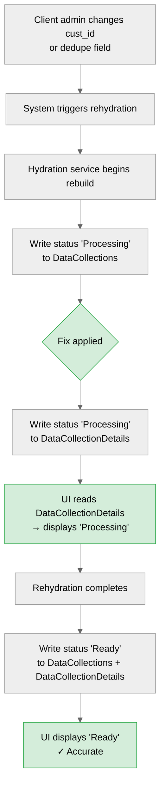

# PRD: Dataset Status Consistency Fix

**Area:** Platform  
**Author:** Chess | **Date:** 2026-05-18 | **Version:** v1  
**Status:** Draft  
**Pipeline stage:** Solution Shaping  
**Product brief:** [brief-dataset-status-sync-2026-05-18.md](../../product-brief-writer/output/platform/brief-dataset-status-sync-2026-05-18.md)  
**ClickUp ref:** [869bbv7dj](https://app.clickup.com/t/869bbv7dj)

---

## Context

- **Strategic fit:** Platform stability and reliability — correct dataset status is foundational to safe consumption across all downstream flows (marketplace, analytics, connections, cleanroom)
- **Related products:** Datasets module, Web App, Hydration service
- **Affected tables:** `[dat].[DataCollections]` / `[dat].[DataCollectionDetails]` — the two tables governing dataset status, written to inconsistently across lifecycle flows
- **Discovery source:** Reported by Rudy (MAF / UAE) — cust_id change triggered rehydration but UI displayed 'Ready' instead of 'Processing'
- **Sprint window:** Sprint 6 — platform squad has capacity; fix now avoids Sev 1 risk in higher-stakes client environments

---

## Problem

When a dataset undergoes rehydration (triggered by a customer identifier or dedupe field change), the dataset status in the UI does not update. The UI reads status from `[dat].[DataCollectionDetails]`, but the rehydration write path only updates `[dat].[DataCollections]`. As a result, users see 'Ready' on a dataset that is actively being rebuilt — creating a silent data integrity risk for any downstream consumer.

This is not an isolated bug. The status write pattern is inconsistent across all dataset lifecycle flows with no single source of truth:

| Flow | Writes to DataCollections | Writes to DataCollectionDetails |
|---|:---:|:---:|
| New Upload | ✓ | ✓ |
| Existing Upload | — | ✓ |
| PII Leak detection | — | ✓ |
| Rehydration (cust_id / dedupe change) | ✓ | — ← **Bug** |
| Prepared Datasets | ❓ | ❓ (unknown) |

There is no enforced contract — which table is authoritative depends on which flow you're in. This is a latent reliability risk across every flow, not just rehydration.

### Evidence

| Source | Signal | Confidence |
|--------|--------|:----------:|
| Rudy (MAF, UAE) — [869bbv7dj](https://app.clickup.com/t/869bbv7dj) | Reproduced: cust_id change → rehydration triggered → status stayed 'Ready' in UI | confirmed |
| Code review (Rudy) | Root cause identified: UI reads DataCollectionDetails; rehydration writes DataCollections only | confirmed |
| Prepared Datasets flow | Status source unknown — not yet investigated | assumed |
| Other rehydration triggers (future) | Any new flow that writes DataCollections only is silently broken | assumed |

### Context

- **Dynamic:** Internal-push — platform team initiative; immediate client exposure via MAF
- **Operational context:** Latent architectural gap — no documented status ownership rule per flow
- **Impact of inaction:** A downstream consumer (analytics, cleanroom, marketplace) treats a rehydrating dataset as ready and runs queries against stale or mid-rebuild data. The system does not error — it silently serves wrong results. For MAF, this could affect campaign matching or audience accuracy without any visible warning.

---

## Target Segment

- **Internal teams:** Platform engineering (owns the fix), hydration service team (Werner)
- **Platform users:** Client data admins who manage datasets and trigger rehydrations (currently MAF / UAE)
- **Downstream consumers:** Analytics users, cleanroom participants, and marketplace buyers who consume dataset outputs after rehydration
- **Primary persona:** Client data admin — the person who changes a cust_id or dedupe field, watches the UI status, and assumes the dataset is safe to consume when it shows 'Ready'

---

## Technical Architecture

**System components involved:**
- Hydration service — owns the rehydration write path; source of the status update that must be propagated
- `[dat].[DataCollections]` — currently updated during rehydration (status is correct here)
- `[dat].[DataCollectionDetails]` — not updated during rehydration (source of the stale UI display)
- Web App / UI — reads status from DataCollectionDetails for all display

**Integration points:**
- Hydration service write path — the single change point for this fix
- UI status read component — unchanged; fix happens at the write level

**Tenant model:** Multi-tenant, client-scoped. All client datasets share the same table structure; fix applies uniformly across all tenants.

**API surface:** No new API endpoints. No changes to existing API contracts. Internal write logic only.

**Service dependencies:** Hydration service must be investigated and updated first; UI has no changes.

**Service level objectives:**

| Metric | Target | Measurement |
|---|---|---|
| Status display accuracy during rehydration | 100% — UI reflects current rebuild state | QA validation: trigger rehydration, observe status update within one refresh cycle |
| No regression on adjacent flows | 0 new status failures across all 5 lifecycle flows | Regression test suite covering all flows |
| Status rule documented per flow | 5/5 flows documented | Acceptance criteria for Done |

---

## Scope

### In Scope
- Propagate status updates to `[dat].[DataCollectionDetails]` when `[dat].[DataCollections]` is updated during rehydration (cust_id change trigger, dedupe field change trigger)
- Investigate Prepared Datasets flow — identify status source and document write behaviour
- Document the authoritative status write rule for all 5 dataset lifecycle flows (acceptance criterion for Done)

### No-Gos
- Redesigning the dataset status data model or consolidating to a single table
- Changes to the Existing Upload, PII Leak detection, or New Upload flows
- UI changes of any kind
- New status surfaces, notifications, or webhooks
- Any schema migrations

### Rabbit Holes

| Rabbit Hole | Why It Could Expand | Mitigation |
|---|---|---|
| Refactoring to a single canonical write path | Correct long-term fix but scope is unbounded | Fix rehydration case only; document the rule without restructuring; schedule architectural refactor separately |
| Fixing Prepared Datasets in the same PR | If it's also broken, the investigation reveals a second fix | Investigate only; if broken, open a separate ticket with its own sizing |
| Adding status audit logging | Would help future debugging and is legitimately useful | Defer to a follow-up; don't scope it here |
| Extending fix to cover unknown future rehydration triggers | Other triggers may follow the same broken pattern | Document the rule clearly so future flows know which tables to write; no proactive changes to untested paths |

### Future Considerations
- Architectural refactor: single source of truth for dataset status (consolidate to one authoritative table)
- Status event streaming or webhooks so downstream consumers can react to state transitions without polling
- Dataset status audit trail for debugging and client-facing transparency

---

## Solution Direction

Update the rehydration write path in the hydration service to propagate status changes to `[dat].[DataCollectionDetails]` whenever it writes to `[dat].[DataCollections]`. This aligns rehydration with the New Upload flow pattern — both tables reflect current state — without changing any other flow or UI logic.

### Key Flow (Fixed State)

1. Client triggers a cust_id or dedupe field change in the Datasets module
2. Hydration service detects the change and initiates dataset rebuild
3. Hydration service writes status `Processing` to `[dat].[DataCollections]` *(existing behaviour)*
4. **[New]** Hydration service also writes status `Processing` to `[dat].[DataCollectionDetails]`
5. UI reads from `[dat].[DataCollectionDetails]` → displays `Processing` to the user
6. Rehydration completes; hydration service writes `Ready` to both tables
7. UI displays `Ready` — state is accurate

**What this PRD does NOT include:**
- UI component design or layout changes
- SQL schema definitions or table contracts (engineering's tech spec)
- Implementation detail for the hydration service internals

---

## Dependencies

| Type | Dependency | Why Needed | Status / Timeline |
|---|---|---|---|
| Team | Werner (hydration service owner) | Must confirm DataCollectionDetails is not deliberately bypassed before dev starts — if bypass is intentional, fix approach changes | **Blocker** — needed before Sprint 6 dev start |
| Feature | Prepared Datasets status investigation | Determine if a second fix is needed within the same sprint | Sprint 6 start |
| Team | Frontend engineer (read path) | Confirm UI does not fall back to DataCollections if DataCollectionDetails is missing — affects testing approach | Sprint 6 start |

**Critical path:** Werner's confirmation on the intentionality of the DataCollectionDetails bypass during rehydration. If intentional, the fix must propagate through a different mechanism (e.g. a triggered sync rather than an inline write). Dev cannot start until this is resolved.

---

## Success Metrics

### Lagging Indicators (post-launch — did it work?)

| Metric | Baseline | Target | Timeframe |
|---|---|---|---|
| Rehydration status accuracy (UI matches actual state) | 0% — always shows wrong status | 100% | Sprint 6 completion |
| Dataset lifecycle flows with documented status write rule | 0 / 5 | 5 / 5 | Sprint 6 completion |
| Client-reported status confusion issues | 1 open (MAF) | 0 | Post-fix deployment |
| Regression failures on adjacent flows | PLACEHOLDER — no baseline test coverage | 0 | Post-fix QA |

### Leading Indicators (pre-launch — are we on track?)

| Signal | Current | Target | What This Predicts |
|---|---|---|---|
| Werner confirms write path intent | Unknown | Confirmed (yes or no) | Fix approach is correct and won't break hydration logic |
| QA passes on rehydration flow (cust_id + dedupe triggers) | N/A | Pass — status updates within one UI refresh cycle | Fix is correct and works end-to-end |
| Prepared Datasets status source identified | Unknown | Documented | No surprise scope expansion in Sprint 6 |
| All 5 lifecycle flows passing in regression suite | PLACEHOLDER | All passing | No adjacent regressions introduced |

---

## Risks

### V/U/F/V/O Assessment

| Type | Risk | Impact | Mitigation |
|---|---|:---:|---|
| **Value** | Problem is confirmed and client-facing — low risk that we're solving the wrong thing | L | — |
| **Usability** | No UI changes; fix is invisible to users unless something breaks | L | QA the fix; verify status displays correctly |
| **Feasibility** | Fix breaks Existing Upload or PII Leak flow if write path is shared | H | Code review with Werner before dev; scope the write to rehydration trigger only; regression test all flows |
| **Viability** | Prepared Datasets uses a third status model — scope expands into Sprint 6 | M | Investigate first; if broken, create separate ticket and fix in Sprint 6 or defer |
| **Operational** | Regression in any adjacent lifecycle flow — silent breakage of status display elsewhere | H | Full regression suite across all 5 flows before merge |

### Operational Risk — Expanded

- **Blast radius:** The hydration service write path may touch logic shared with Existing Upload or PII Leak flows. A scoping error in the fix could silently break status display in those flows — which currently work correctly.
- **Backward compatibility:** No schema changes, no API changes. The fix is additive — new writes to an existing table. No existing integrations break.
- **Migration safety:** No data migration required. Fix takes effect immediately on deployment for all future rehydration events. Historical rehydrations are unaffected.
- **Multi-tenancy:** Dataset tables are client-scoped; the fix applies uniformly across all tenants. No tenant-specific risk.
- **On-call burden:** No new operational surface introduced. If the fix causes a regression, it will surface as a status display issue in existing monitoring. Engineering team owns the fix; no new on-call rotation.

---

## Open Questions

| Question | Who Can Answer | Needed By | Validation Approach |
|---|---|---|---|
| Is DataCollectionDetails deliberately bypassed during rehydration? If yes, why? | Werner (hydration service) | Before Sprint 6 dev start — **blocker** | Direct question + code review of the rehydration write path in hydration service |
| What is the status source for Prepared Datasets? Is it broken in the same way? | Hydration service / dataset team | Sprint 6 start | Code trace through Prepared Datasets flow + DB inspection of DataCollections vs DataCollectionDetails for a live Prepared Dataset |
| Does the UI fall back to DataCollections if DataCollectionDetails is missing or stale? | Frontend engineer | Sprint 6 start | Read the UI status component logic; check for any conditional read path |
| What QA coverage currently exists for dataset lifecycle status flows? | QA / engineering | Sprint 6 start | Audit existing test suite; identify gaps before writing regression tests |

---

## Sign-off

| Role | Name | Status |
|---|---|---|
| Product owner | Chess | Draft |
| Engineering lead | | Pending |
| Hydration service owner | Werner | Pending — **required before dev starts** |
| QA | | Pending |

---

## Version History

| Version | Date | Author | Changes |
|---|---|---|---|
| v1 | 2026-05-18 | Chess | Initial draft from approved product brief |
