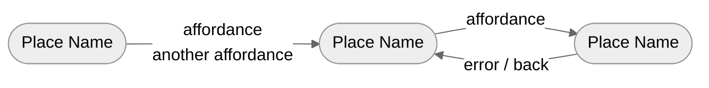
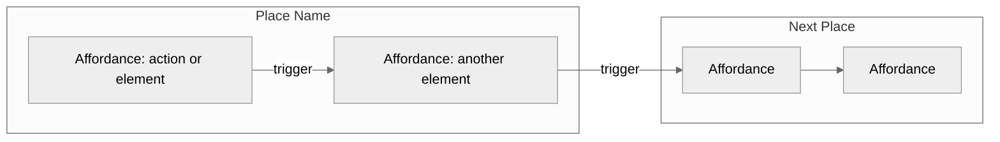
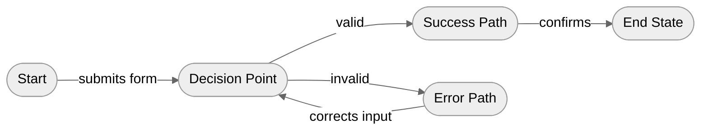
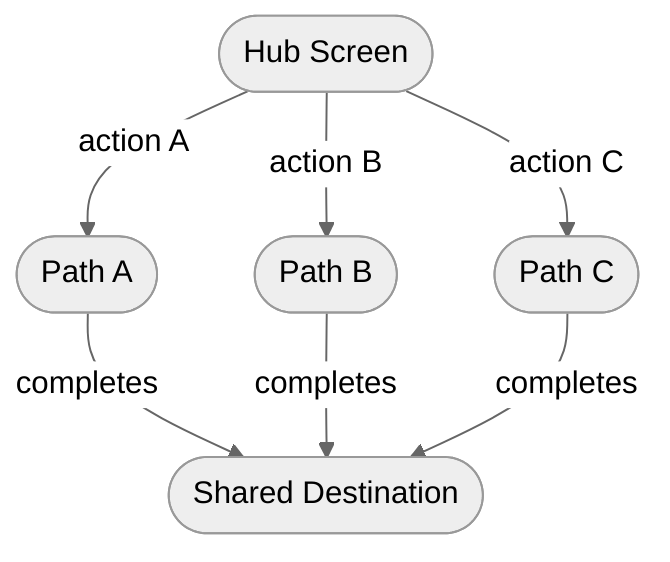
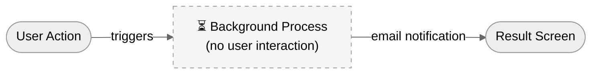
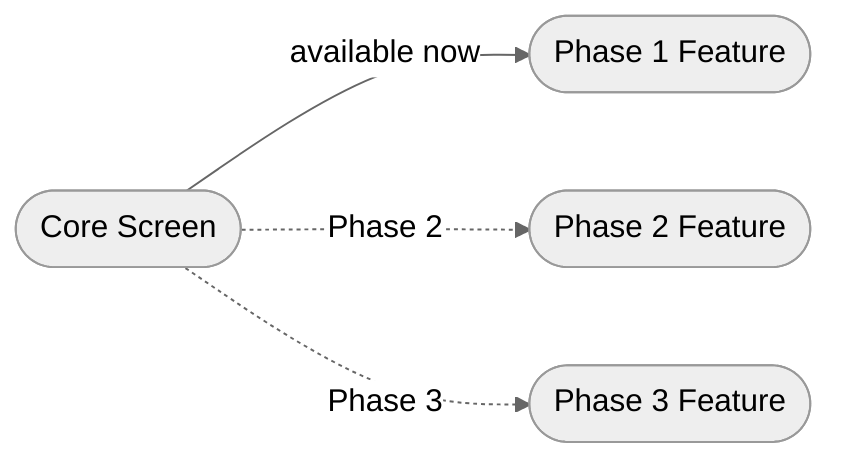

# Breadboard Mermaid Patterns

All breadboards use `%%{init: {'theme': 'neutral'}}%%` for light/dark mode compatibility.

---

## Pattern 1: Simple Breadboard

Best for: Quick ideation, simple flows, early shaping.

**Places** = Stadium-shaped nodes `(["..."])`
**Affordances** = Edge labels (what the user does to move between places)
**Connections** = Arrows between places



**Rules:**
- One node per Place — keep names short (2-4 words)
- Edge labels list the key affordances that trigger the transition
- Use `\n` to stack multiple affordances on one edge
- Use `LR` (left-to-right) for linear flows, `TD` (top-down) for hierarchical ones
- Error/back paths go right-to-left or bottom-to-top

---

## Pattern 2: Detailed Breadboard

Best for: Complex flows, stakeholder communication, PRD-level shaping.

**Places** = Subgraphs (named blocks)
**Affordances** = Nodes inside subgraphs
**Connections** = Arrows between nodes across subgraphs



**Rules:**
- Subgraph titles are Place names — use quotes for multi-word names
- Nodes inside represent what the user can see or do at that Place
- Arrows between nodes show flow (with optional trigger labels)
- Use `---` (no arrowhead) for co-located items that don't imply sequence
- Keep affordance descriptions to 3-5 words max

---

## Pattern 3: Branching Flow

For flows with conditional paths (success/failure, role-based, phased rollout).



---

## Pattern 4: Parallel Paths

For flows where users can take multiple independent actions from one Place.



---

## Pattern 5: Async / Background Process

For steps that happen without user interaction (processing, email triggers, scheduled jobs).



**Rules:**
- Use dashed stroke for background/async steps
- Always show how the user is notified when the process completes
- Label clearly that no user interaction occurs

---

## Pattern 6: Phased Rollout

For features delivered in phases, showing what's available when.



**Rules:**
- Solid arrows for current-phase connections
- Dotted arrows (`-.->`) for future-phase connections with phase label
- Helps stakeholders see the delivery roadmap visually

---

## Visual Legend (include in generated diagrams)

Add this legend below every breadboard diagram so readers can interpret the notation without prior Shape Up knowledge.

```markdown
### Legend
| Symbol | Meaning |
|--------|---------|
| **Bordered group** (subgraph) | Place — a screen, page, or state the user visits |
| **Rectangle** inside a group | Affordance — something the user can see or do |
| **Solid arrow** `-->` with label | Connection — user action that triggers a transition |
| **Line without arrow** `---` | Co-located items — no sequence implied |
| **Dashed border** | Background/async step — no user interaction |
| **Red box** ❌ | Error or failure state |
| **Dotted arrow** `-.->` | Future phase — not yet available |
```

---

## Node Naming Conventions

| Element | Format | Example |
|---------|--------|---------|
| Place (simple) | `P1(["Name"])` | `P1(["Dashboard"])` |
| Place (detailed) | `subgraph "Name"` | `subgraph "Project Config"` |
| Affordance | `A1["Description"]` | `A1["Select template"]` |
| System step | `S1["⏳ Description"]` | `S1["⏳ Processing"]` |
| Error state | `E1["❌ Description"]` | `E1["❌ Validation failed"]` |

Use prefixes per Place for readability: Place 1 affordances = A1, A2; Place 2 = B1, B2; etc.

---

## Complexity Guidelines

| Flow steps | Recommended pattern |
|------------|-------------------|
| 3-5 | Simple breadboard |
| 6-10 | Detailed breadboard |
| 10+ | Split into sub-flows (happy path + error handling + admin) |
| Multiple actors | Separate breadboard per actor, or use subgraph columns |
