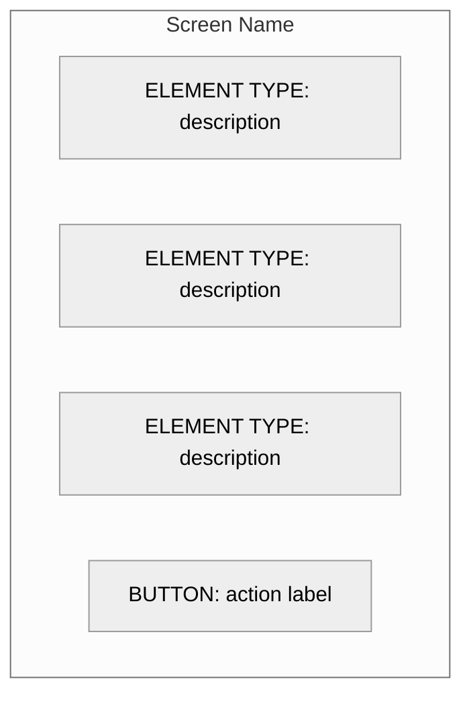
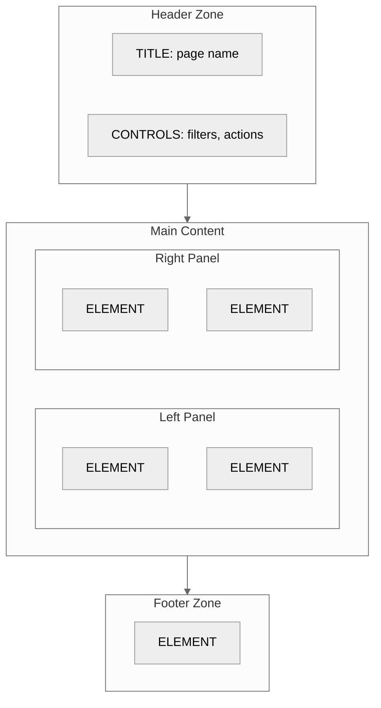
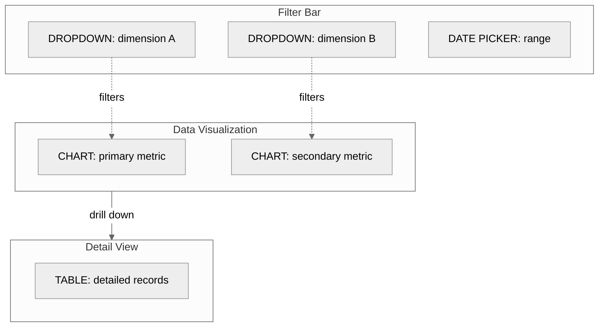
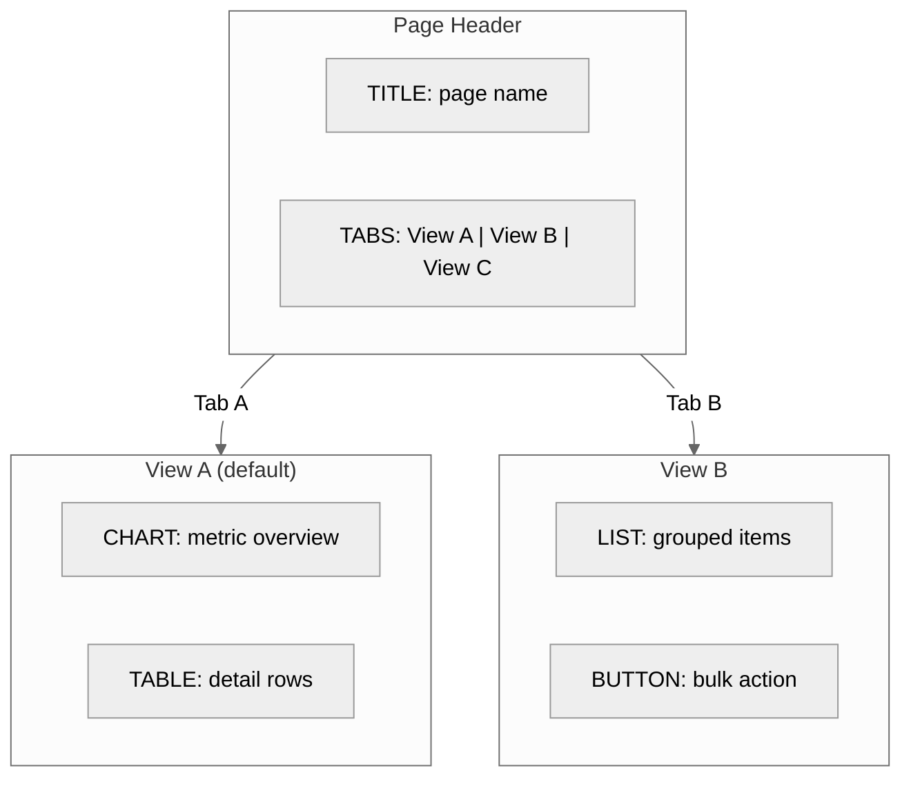

# Fat Marker Sketch Mermaid Patterns

All sketches use `%%{init: {'theme': 'neutral'}}%%` for light/dark mode compatibility.

Fat marker sketches show **what goes where** on a screen — rough zones and element types, not pixel-level layout.

---

## Pattern 1: Simple Screen Layout

Best for: Single-purpose screens, forms, simple views.

**Rules:**
- One subgraph = one screen
- Elements listed top to bottom = visual reading order
- Use ALL CAPS for element types
- Keep descriptions to 2-4 words

---

## Pattern 2: Zoned Layout

Best for: Dashboards, multi-panel screens, complex views.

**Rules:**
- Top-level subgraphs = major screen zones (header, main, sidebar, footer)
- `direction LR` inside a zone creates side-by-side columns
- Solid arrows (`-->`) between zones show visual hierarchy / reading order
- Don't nest more than 2 levels deep

---

## Pattern 3: Data Flow Layout

Best for: Screens with filtering, drill-down, or interactive data relationships.

**Rules:**
- Dotted arrows (`-.->`) show data flow / filtering relationships
- Solid arrows show user navigation flow (clicking to drill down)
- Label filter relationships to clarify what drives what

---

## Pattern 4: Multi-Tab / Multi-View

Best for: Screens with tabs, toggles, or mode switches.

---

## Element Type Labels

Use these standard labels for consistency:

| Label | Represents |
|-------|-----------|
| `TITLE` | Page or section heading |
| `BUTTON` | Clickable action |
| `LINK` | Navigation link |
| `DROPDOWN` | Selection control |
| `INPUT` | Text entry field |
| `TOGGLE` | On/off switch |
| `CHECKBOX` | Multi-select option |
| `DATE PICKER` | Date selection |
| `SEARCH` | Search field |
| `TABLE` | Data table |
| `LIST` | Ordered/unordered list |
| `CHART` | Any data visualization |
| `CARD` | Content card / tile |
| `FORM` | Group of input fields |
| `TABS` | Tab navigation |
| `NAV` | Navigation menu |
| `BREADCRUMB` | Path navigation |
| `BADGE` | Status indicator |
| `ALERT` | Notification / warning |
| `MODAL` | Overlay dialog |
| `EMPTY STATE` | No-data placeholder |

---

## Layout Direction Guide

| Layout need | Mermaid approach |
|-------------|-----------------|
| Vertical stack (most screens) | `flowchart TD` (default) |
| Side-by-side panels | `direction LR` inside a subgraph |
| Grid of cards | Multiple nodes in a `direction LR` subgraph |
| Sidebar + main | Nested subgraphs with `direction LR` |
| Full-width sections stacked | Top-level subgraphs connected with `-->` |

---

## Complexity Guidelines

| Screen complexity | Recommended approach |
|-------------------|---------------------|
| Simple form or list | Pattern 1 (simple layout) |
| Dashboard with zones | Pattern 2 (zoned layout) |
| Data-heavy with filters | Pattern 3 (data flow) |
| Multi-view screen | Pattern 4 (multi-tab) |
| Very complex screen | Split into multiple sketches (one per tab/mode) |

---

## Connecting Fat Marker Sketches to Breadboards

When generating both diagram types, name fat marker sketch subgraphs to match breadboard Place names. This creates a clear mapping:

- Breadboard Place: `(["Dashboard"])` → Fat marker: `subgraph Dashboard["Dashboard"]`
- Breadboard Place: `(["Config Screen"])` → Fat marker: `subgraph Config["Config Screen"]`

Generate one fat marker sketch per key Place identified in the breadboard. Skip Places that are simple (confirmation dialogs, loading states) — only sketch screens with meaningful layout decisions.
