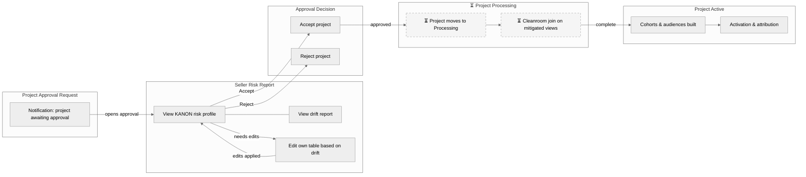
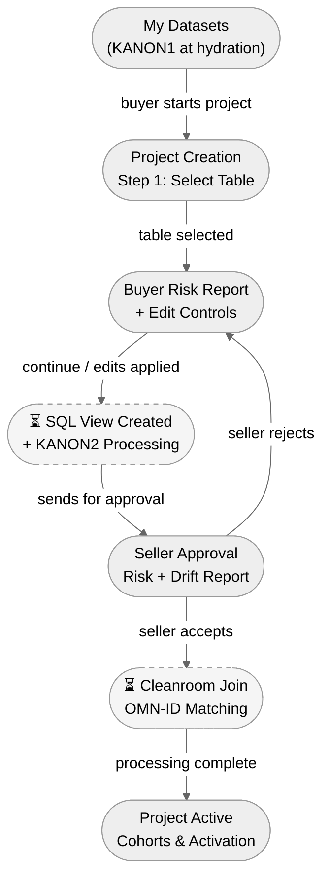
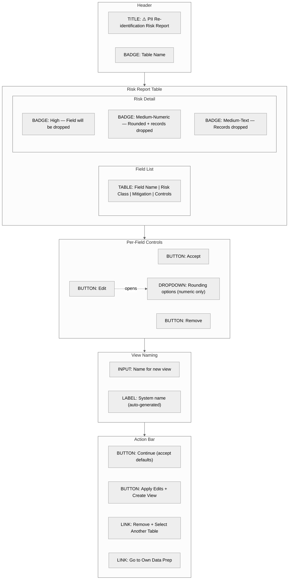
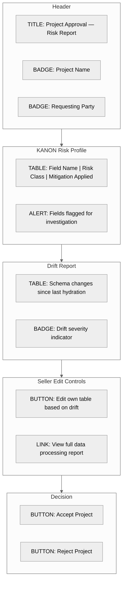
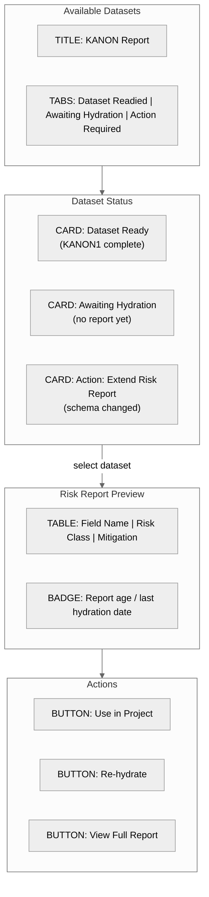

# Shape: Better KANON Visibility and Control

**Date:** 2026-03-16
**Mode:** From PRD
**Related PRD:** [PRD_KANON_Visibility_Control.md](PRD_KANON_Visibility_Control.md)

---

## Breadboard 1: Buyer Flow (Project Creation)

The buyer selects their own dataset during project creation and is presented with the KANON risk report. They can continue with defaults, edit fields, swap tables, or exit to Own Data Prep.

```mermaid
%%{init: {'theme': 'neutral'}}%%
flowchart LR
    subgraph "My Datasets"
        A1["Upload & register data"]
        A2["⏳ KANON1 runs during hydration"]
        A3["Risk report stored with dataset"]
    end

    subgraph "Project Creation — Step 1"
        B1["Select own table"]
        B2["Platform fetches KANON1 report"]
    end

    subgraph "Risk Report (Buyer)"
        C1["View field risk classes"]
        C2["Per-field controls: Accept / Remove / Edit rounding"]
        C3["Name the view"]
    end

    subgraph "Own Data Prep"
        D1["Create new table manually"]
        D2["Re-register + hydrate"]
    end

    subgraph "⏳ Project Processing"
        E1["⏳ SQL View created in _A schema"]
        E2["⏳ KANON2: drop, round, remove identifiers"]
        E3["⏳ New table registered"]
    end

    subgraph "Project Step 2+"
        F1["Continue project creation with mitigated view"]
    end

    E4["❌ No report found"]

    A1 -->|"registers"| A2
    A2 -->|"stores"| A3
    A3 -->|"user starts project"| B1
    B1 -->|"table selected"| B2
    B2 -->|"report exists"| C1
    B2 -->|"no report"| E4
    E4 -->|"Go to Own Data Prep"| D1
    E4 -->|"Select another table"| B1
    C1 -->|"Continue (accept defaults)"| E1
    C1 -->|"Edit fields"| C2
    C2 --> C3
    C3 -->|"Apply edits"| E1
    C1 -->|"Remove + Create New"| B1
    C1 -->|"Go to Own Data Prep"| D1
    D1 --> D2
    D2 -->|"re-registered"| B1
    E1 --> E2
    E2 --> E3
    E3 -->|"view ready"| F1

    style A2 fill:#f5f5f5,stroke:#999,stroke-dasharray: 5 5
    style E1 fill:#f5f5f5,stroke:#999,stroke-dasharray: 5 5
    style E2 fill:#f5f5f5,stroke:#999,stroke-dasharray: 5 5
    style E3 fill:#f5f5f5,stroke:#999,stroke-dasharray: 5 5
    style E4 fill:#fee,stroke:#c00
```

---

## Breadboard 2: Seller Flow (Project Approval)

The seller receives a project approval request and is shown the risk report and drift report for the data entering the collaboration. They can accept, reject, or edit their own table before approving.

---

## Breadboard 3: Combined Overview (Both Actors)

High-level end-to-end showing how buyer and seller flows connect.

### Legend
| Symbol | Meaning |
|--------|---------|
| **Bordered group** (subgraph) | Place — a screen, page, or state the user visits |
| **Rectangle** inside a group | Affordance — something the user can see or do |
| **Solid arrow** `-->` with label | Connection — user action that triggers a transition |
| **Line without arrow** `---` | Co-located items — no sequence implied |
| **Dashed border** | Background/async step — no user interaction |
| **Red box** | Error or blocked state |

---

## Fat Marker Sketches

### Buyer Risk Report (Project Creation — Step 1)

The primary screen where the buyer reviews field-level risk and decides how to proceed.

### Seller Approval Risk Report

The screen shown to the data owner when approving a project.

### Dataset Risk Report (My Datasets / Available Datasets)

The pre-computed risk report stored with the dataset, viewable outside project context.

---

## Flow Notes

- **KANON1 is pre-computed** — runs at hydration (dataset registration), never at project creation time. This is critical for performance — the report is always ready instantly.
- **KANON2 runs during project processing** — this is the step that actually drops columns, rounds fields, and removes identifiable records. It happens after the buyer confirms edits and creates the SQL view.
- **Seller rejection loops back** — if the seller rejects, the buyer may need to re-edit fields and resubmit. The seller always sees the final mitigated state at acceptance time.
- **Edge case: no report** — blocks the buyer from continuing. They must re-register the dataset or choose a different table.
- **Priority TBD** — which ships first: Buyer Risk Report (project creation) or Seller Approval Risk Report? See Open Questions in PRD.
